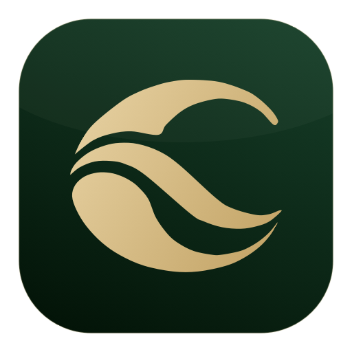
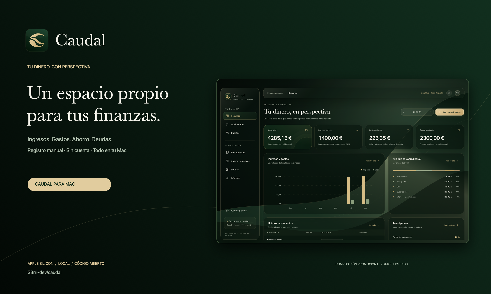
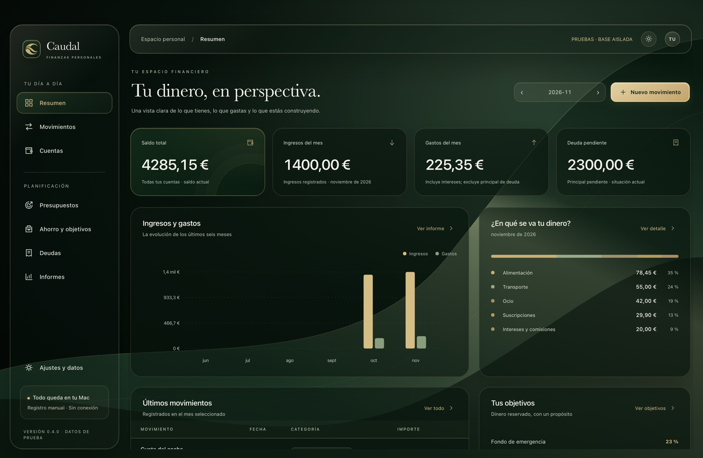
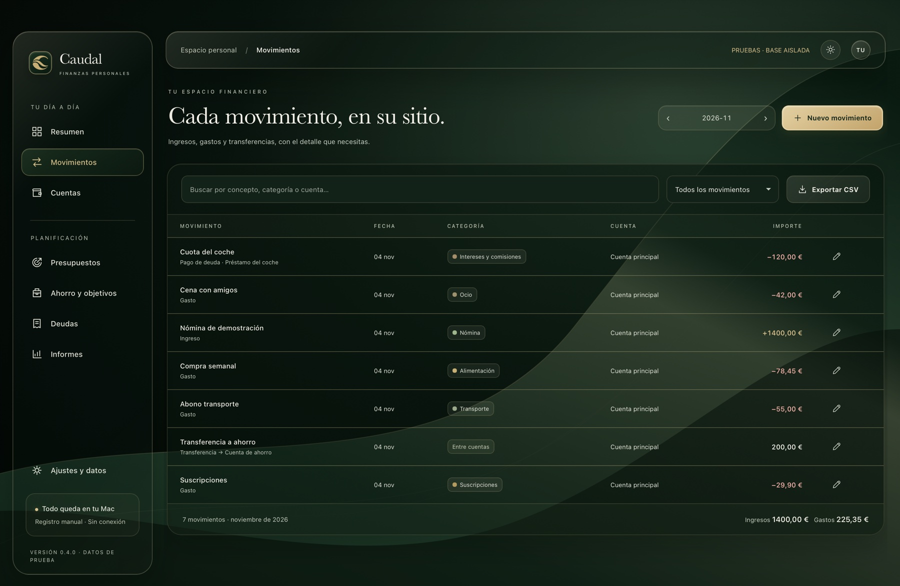
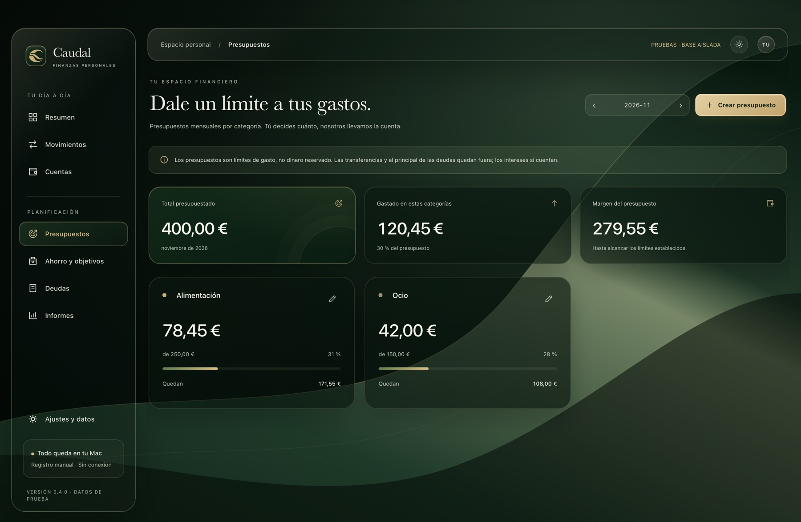
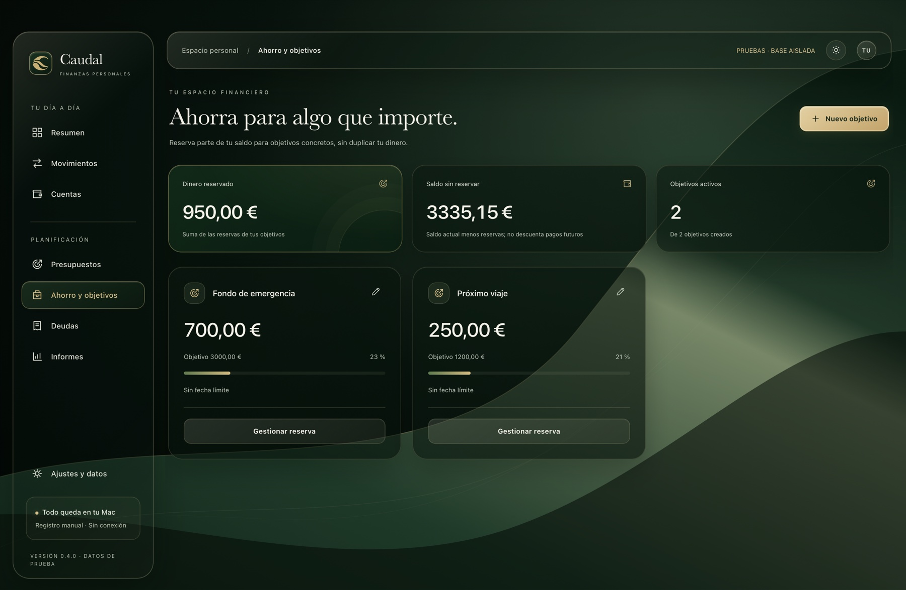
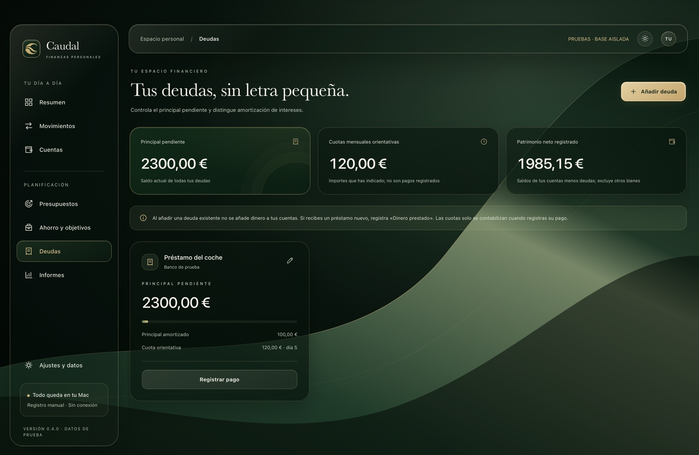
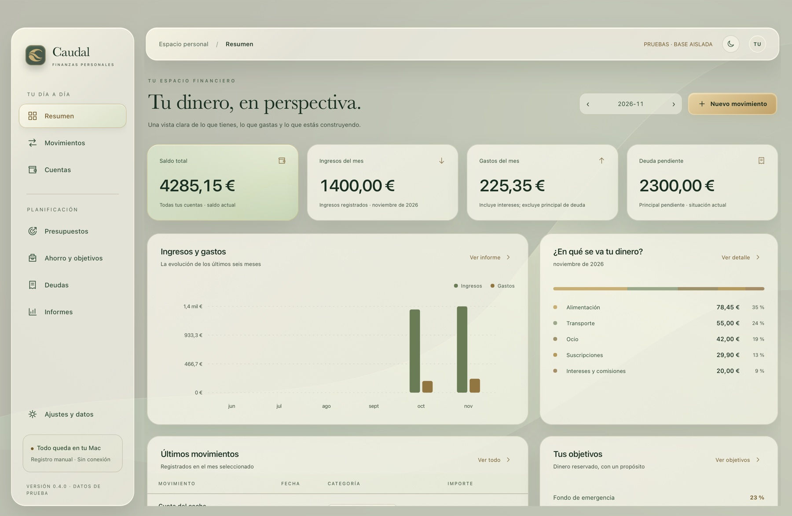

<div align="center">


# Caudal

### Your money, in perspective.

Income, expenses, budgets, savings and debt. On your Mac.

**[Download for Mac](https://github.com/S3rri-dev/caudal/releases/latest)** · **[Getting started (Spanish)](docs/GETTING_STARTED.md)** · **[Support](SUPPORT.md)**

[Español](README.md) · English
</div>



*Promotional composition using a real app screenshot and fictional data.*

## What it does

Caudal is a local personal finance app for Apple Silicon Macs. Enter transactions manually; there is no account, server or bank connection. A fresh installation starts empty.

- Income and expenses with editing, search and monthly filters.
- Accounts and transfers that do not inflate income or spending.
- Monthly category budgets, with progress and overspending.
- Virtual savings reserves that allocate existing money without moving it.
- Debt tracking with principal separated from interest and fees; borrowed money is not income.
- Six-month charts, category breakdowns and explained balance changes.
- CSV export, full SQLite backups and restore preview with a backup before replacement.

Forest green, gold, black and ivory; translucent materials; dark, light and system themes. macOS accessibility preferences reduce transparency and motion or increase contrast.

## Screenshots

Real app/WebKit captures with fictional test data. The download does not include these records.



| Transactions | Budgets |
| --- | --- |
|  |  |

| Savings | Debt |
| --- | --- |
|  |  |



## Install

Download **Caudal-0.4.0-arm64.dmg** from [Releases](https://github.com/S3rri-dev/caudal/releases/latest), mount it and drag Caudal.app to Applications. An app ZIP is also available. Open it and choose **Añadir mi primera cuenta** to enter your starting balance.

Apple Silicon only; deployment target macOS 13. See [actual verification](docs/VERIFICACION.md) for the tested system. Builds use an **ad hoc signature**, with no Developer ID or notarization. Gatekeeper may block first launch. Follow the [installation guide](docs/INSTALL.md); do not disable system security globally.

The app UI and detailed guides are currently in Spanish. Dates use Europe/Madrid and amounts use EUR.

## Data and privacy

Data is stored outside the bundle in `~/Library/Application Support/Caudal/`. No analytics, ads or network requests from the UI. SQLite files have no app-level encryption. Full backups include accounts, transactions, budgets, goals and debts; CSV only includes transactions. [Privacy](docs/PRIVACY.md) · [Permissions](docs/PERMISSIONS.md) · [Backups](docs/DATA.md).

Public Caudal and Caudal Dev have distinct bundle IDs and default data folders. Neither automatically imports previous personal editions or other applications' records.

## Build

Use an Apple Silicon Mac with Xcode Command Line Tools and Python 3. No downloaded application dependencies.

```sh
git clone https://github.com/S3rri-dev/caudal.git
cd caudal
./scripts/build.sh
./tests/run.sh
./tests/run-ui.sh
python3 scripts/audit_publication.py --bundle dist/Caudal.app
```

UI tests require a logged-in graphical macOS session and use isolated fictional data. `./scripts/build.sh --dev` builds Caudal Dev with separate storage. [Contributing](CONTRIBUTING.md) · [Architecture](docs/ARCHITECTURE.md) · [Release process](docs/RELEASING.md).

## Status

0.4.0 is the first public testing edition. No bank connectivity, investments, sync, AI, multiple currencies, CSV import or automatic recurring payments. Opening balances have no opening date; balances are current, while flow reports are monthly. Debt instalments are references, not automatic payments or interest calculations.

No external security or financial audit has been performed. Technical checks do not establish compatibility with every Mac or everyday usability. [Roadmap](docs/ROADMAP.md) · [Changelog](CHANGELOG.md) · [Troubleshooting](docs/TROUBLESHOOTING.md).

## License and identity

Copyright © 2026 S3rri-dev and contributors. Code: **GPL-3.0-or-later**, without warranty; see [LICENSE](LICENSE). The Caudal name and wave C are covered separately by [TRADEMARKS.md](TRADEMARKS.md), without claiming a registered trademark. [Resource provenance](THIRD_PARTY_NOTICES.md).

Repository presentation inspired by [Nodal](https://github.com/S3rri-dev/nodal) and [vorssaint-utils](https://github.com/vorssaint/vorssaint-utils). Caudal is an independent project.
