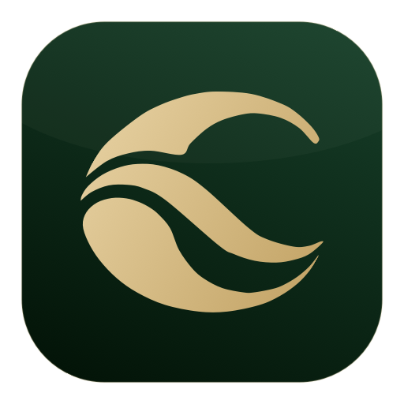
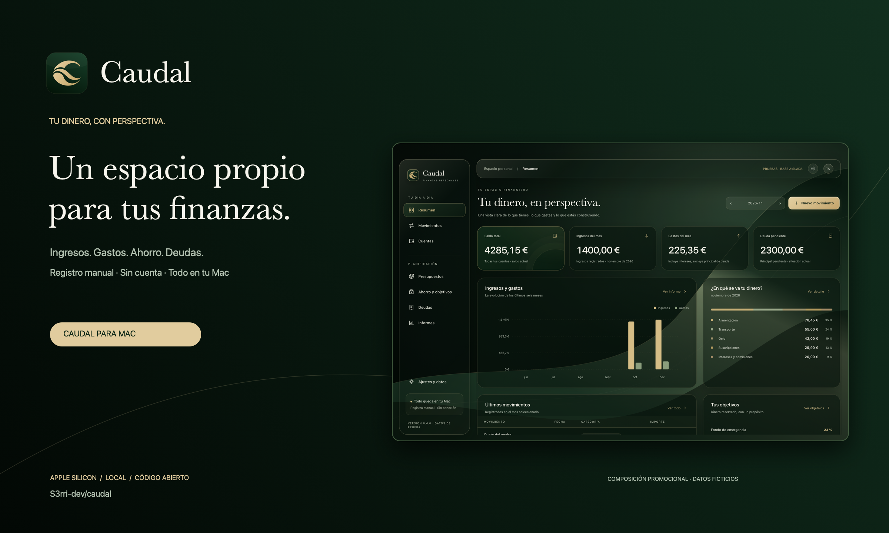
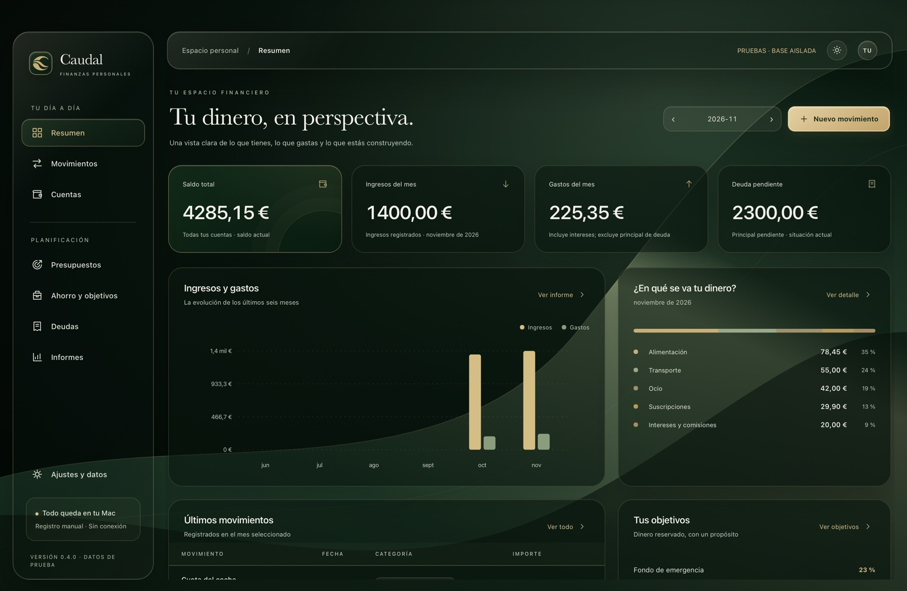
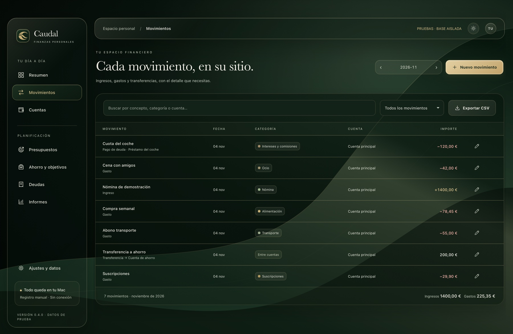
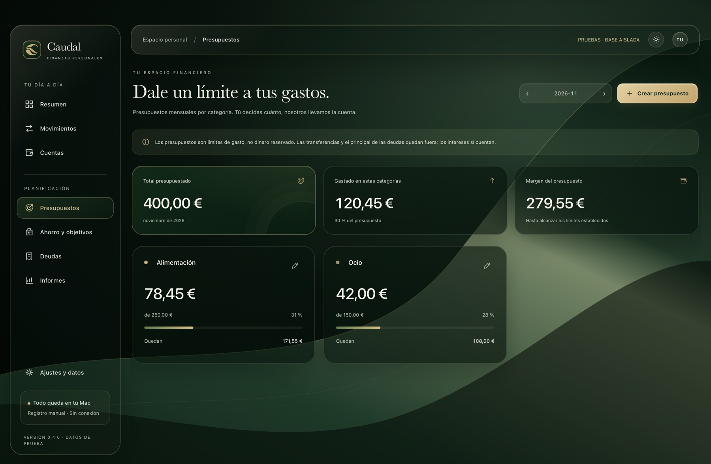
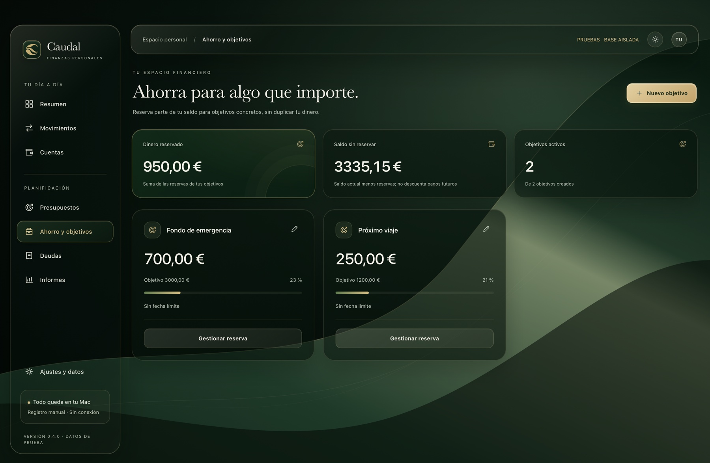
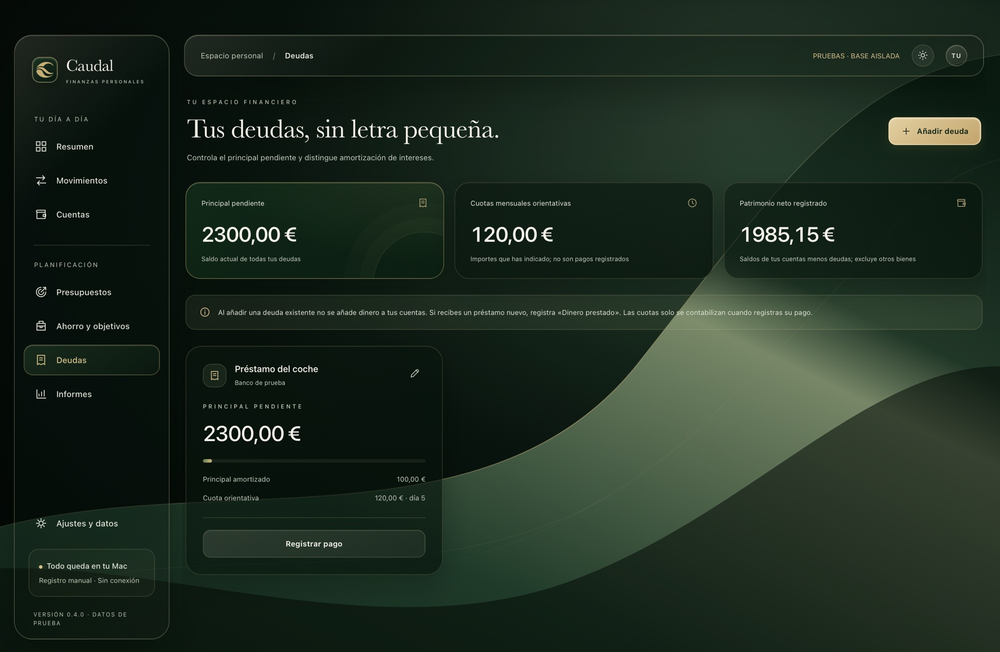
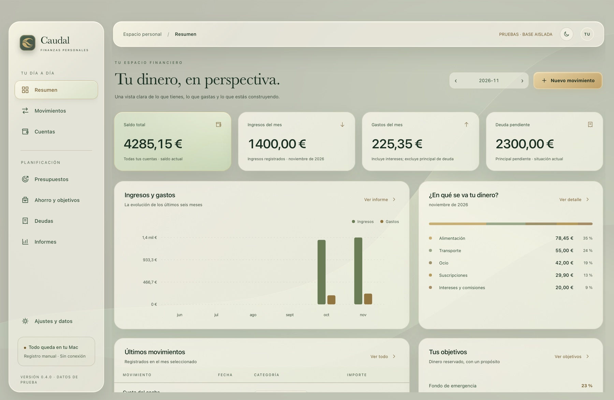

<div align="center">


# Caudal

### Tu dinero, con perspectiva.

Ingresos, gastos, presupuestos, ahorro y deudas. En tu Mac.

[](https://github.com/S3rri-dev/caudal/actions/workflows/ci.yml)
[](LICENSE)
[](docs/INSTALL.md)

**[Descargar para Mac](https://github.com/S3rri-dev/caudal/releases/latest)** · **[Primeros pasos](docs/GETTING_STARTED.md)** · **[Caso técnico](https://github.com/S3rri-dev/S3rri-dev/blob/main/proyectos/caudal.md)** · **[Ayuda](SUPPORT.md)**

Español · [English](README.en.md)
</div>



*Portada promocional compuesta con una captura real y datos ficticios.*

## Una vista clara de tus finanzas

Caudal organiza el dinero que registras manualmente. Funciona sin cuenta, servidor o conexión bancaria. La primera apertura está vacía: tú añades tu primera cuenta y su saldo de partida.

- **Ingresos y gastos.** Registra, edita y busca movimientos; filtra por mes y tipo.
- **Cuentas y transferencias.** Mueve dinero entre tus cuentas sin inflar ingresos o gastos.
- **Presupuestos.** Límites mensuales por categoría con consumo y exceso visibles.
- **Ahorro.** Reserva parte del saldo existente para objetivos. La reserva no crea ni mueve dinero.
- **Deudas.** Registra principal pendiente, préstamos recibidos y cuotas; separa devolución de principal de intereses y comisiones.
- **Informes.** Gráfica de seis meses, categorías y explicación de la variación del saldo.
- **Datos bajo tu control.** CSV de movimientos, copias completas SQLite y restauración con vista previa y copia previa.

Verde bosque, dorado, negro y marfil. Cristal translúcido con temas oscuro, claro y sistema; adaptación a las preferencias de accesibilidad de macOS.

## Así se ve

Capturas reales de WebKit dentro de la aplicación, con datos ficticios de demostración. No son finanzas de una persona ni datos precargados en la descarga.



| Movimientos | Presupuestos |
| --- | --- |
|  |  |

| Ahorro | Deudas |
| --- | --- |
|  |  |



## Instalar

1. Descarga **Caudal-0.4.0-arm64.dmg** de [Releases](https://github.com/S3rri-dev/caudal/releases/latest).
2. Monta el DMG y arrastra **Caudal.app** a Aplicaciones. También se ofrece un ZIP de la aplicación.
3. Abre Caudal y pulsa **Añadir mi primera cuenta**.

Apple Silicon; objetivo mínimo de compilación macOS 13. Pruebas reales y plataformas: [Verificación](docs/VERIFICACION.md).

**Firma ad hoc, sin Developer ID ni notarización.** macOS puede bloquear el primer arranque. Consulta [Instalación](docs/INSTALL.md) antes de autorizar una aplicación descargada. El DMG no ejecuta un instalador con privilegios.

## Local, desde el primer movimiento

Los datos viven en `~/Library/Application Support/Caudal/`, fuera del bundle. No hay telemetría, publicidad, cuenta de acceso ni peticiones de red de la interfaz. SQLite no tiene cifrado propio de Caudal. [Privacidad](docs/PRIVACY.md) · [Permisos](docs/PERMISSIONS.md) · [Datos y copias](docs/DATA.md).

La edición pública y **Caudal Dev** tienen identificadores y almacenamiento diferentes. No leen automáticamente los datos de ediciones personales anteriores ni los de otras aplicaciones.

## Compilar y probar

Mac Apple Silicon con Xcode Command Line Tools y Python 3. No se descargan paquetes para construir la aplicación.

```sh
git clone https://github.com/S3rri-dev/caudal.git
cd caudal
./scripts/build.sh
./tests/run.sh
./tests/run-ui.sh
python3 scripts/audit_publication.py --bundle dist/Caudal.app
```

La prueba UI abre AppKit/WebKit real: requiere una sesión gráfica de macOS. Para desarrollar con datos separados:

```sh
./scripts/build.sh --dev
open 'dist/Caudal Dev.app'
```

[Contribuir](CONTRIBUTING.md) · [Arquitectura](docs/ARCHITECTURE.md) · [Publicar una versión](docs/RELEASING.md).

## Estado y límites

**0.4.0 · primera edición pública de prueba.** Registro manual en EUR, interfaz española y fechas Europe/Madrid. No incluye conexión bancaria, inversiones, sincronización, IA, multimoneda, importación CSV ni pagos recurrentes automáticos. Los saldos iniciales no tienen fecha de apertura: el saldo es actual, los informes de flujos sí se filtran por mes. Las cuotas son referencias, no pagos automáticos.

El producto no ha pasado auditoría financiera o de seguridad externa. Las pruebas técnicas no acreditan compatibilidad en todos los Mac ni comodidad de uso diario. [Roadmap](docs/ROADMAP.md) · [Historial](CHANGELOG.md) · [Solución de problemas](docs/TROUBLESHOOTING.md).

## Código e identidad

Copyright © 2026 S3rri-dev y colaboradores. Código **GPL-3.0-or-later**, sin garantía: [LICENSE](LICENSE). El nombre y la C de ondas se rigen por [TRADEMARKS.md](TRADEMARKS.md); no se afirma registro de marca. [Procedencia de los recursos](THIRD_PARTY_NOTICES.md).

Estructura de publicación inspirada en [Nodal](https://github.com/S3rri-dev/nodal) y [vorssaint-utils](https://github.com/vorssaint/vorssaint-utils). Caudal es un proyecto independiente.
